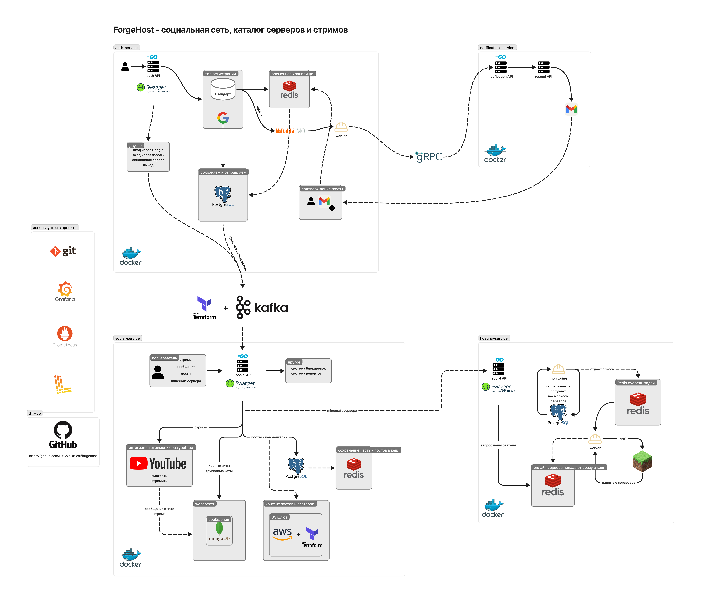
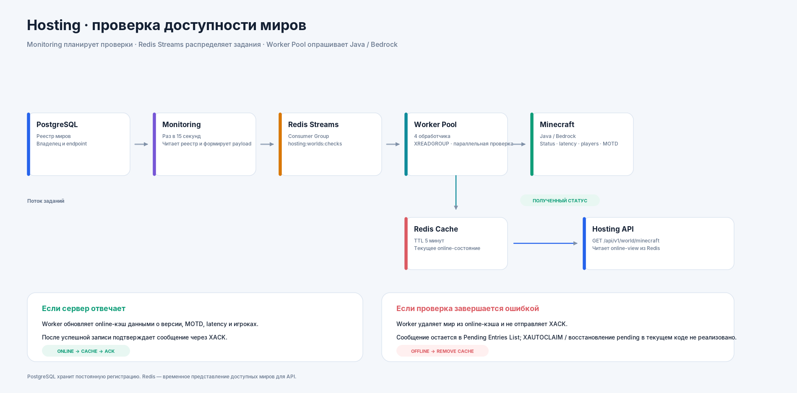
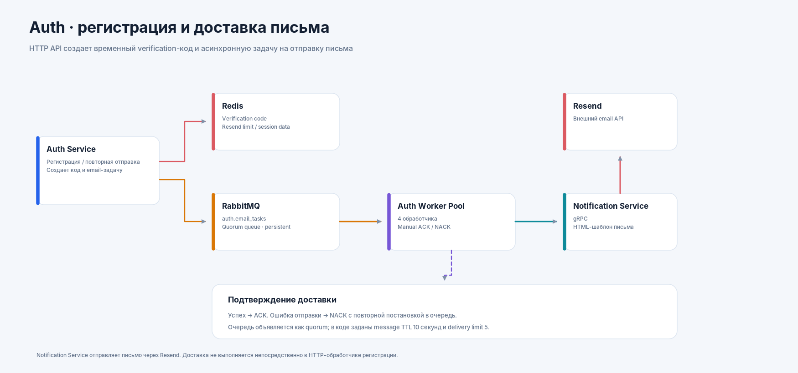
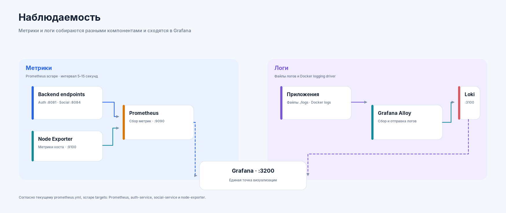

<div align="center">

# ForgeHost

### Backend-платформа для игровой соц сети: аккаунты, социальные функции, чаты, YouTube-интеграция и мониторинг Minecraft-миров.

[](https://go.dev/)
[](https://docs.docker.com/compose/)
[](https://www.postgresql.org/)
[](https://redis.io/)
[](https://www.mongodb.com/)
[](https://kafka.apache.org/)
[](https://www.rabbitmq.com/)
[](https://www.terraform.io/)

**[Репозиторий](https://github.com/BitCoinOffical/forgehost) · [CI](https://github.com/BitCoinOffical/forgehost/actions)**

</div>

---

## Содержание

- [О проекте](#о-проекте)
- [Возможности](#возможности)
- [Архитектура](#архитектура)
- [Сервисы](#сервисы-и-ответственность)
- [Хранение данных и обмен сообщениями](#хранение-данных-и-обмен-сообщениями)
- [Технологический стек](#технологический-стек)
- [Структура репозитория](#структура-репозитория)
- [Локальный запуск](#локальный-запуск)
- [Проверки и качество кода](#проверки-и-качество-кода)
- [API и документация](#api-и-документация)
- [Границы текущей реализации](#границы-текущей-реализации)

## О проекте

**ForgeHost** — модульная backend-платформа для игровых сообществ. Проект объединяет управление пользователями и доступом, социальные функции, переписки в реальном времени, интеграцию с YouTube, асинхронную отправку писем и мониторинг доступности Minecraft Java / Bedrock.

Backend разделён на четыре самостоятельных Go-модуля. Для разных задач используются отдельные хранилища и механизмы обмена сообщениями: PostgreSQL хранит постоянные реляционные данные, Redis — временное состояние и кэш, MongoDB — сообщения личных и групповых чатов, SeaweedFS предоставляет S3-совместимое объектное хранилище, а Kafka, RabbitMQ и Redis Streams обслуживают разные сценарии асинхронной обработки.

## Возможности

| Направление | Что реализовано |
|---|---|
| **Аккаунты и авторизация** | Регистрация по email и паролю, подтверждение email, вход и выход, обновление access token, смена и сброс пароля, Google OAuth для Web и Android. |
| **Профили и социальный граф** | Профили пользователей, подписки на пользователей и темы, блокировки, жалобы и управление информацией профиля. |
| **Публикации** | Темы, публикации, ленты подписок и общая лента, курсорная пагинация, просмотры, комментарии, лайки и жалобы. |
| **Чаты** | Личные и групповые чаты, участники и роли, модерация, баны, отметка прочитанного, история сообщений и доставка событий через WebSocket. |
| **YouTube** | Подключение канала через OAuth с областью доступа `youtube.readonly`, получение идентификатора канала, регистрация и получение метаданных трансляций, участники и чат трансляции. |
| **Изображения и файлы** | Загрузка изображений публикаций и аватаров в S3-совместимое хранилище SeaweedFS. Для изображений публикаций проверяются JPEG, PNG и WebP; максимальный размер файла — 10 МБ. |
| **Уведомления** | Асинхронные задачи отправки писем через RabbitMQ, отдельный gRPC-сервис уведомлений и Resend. |
| **Minecraft-мониторинг** | Регистрация миров Java / Bedrock, периодические проверки протокола, параллельные обработчики, latency, версия, MOTD и количество игроков. |

## Архитектура

### Общая схема



https://www.figma.com/board/rC2kYrgvvfJFtsc2Bf3eT0/forgehost?node-id=0-1&p=f&t=8PBkllmBl9Zyzncp-0

### Мониторинг Minecraft-миров

PostgreSQL — источник постоянных регистрационных данных. Процесс `hosting-monitoring` раз в 15 секунд читает список миров и публикует задания в Redis Streams. `hosting-worker` запускает четыре обработчика: они получают сообщения из Consumer Group, проверяют Java / Bedrock endpoint и обновляют временный online-кэш.



**Успешная проверка:** Worker сохраняет статус, latency, версию, MOTD и данные об игроках в Redis, после чего подтверждает сообщение через `XACK`.

### Регистрация и отправка email

Регистрация не отправляет письмо непосредственно из HTTP-обработчика. Auth Service сохраняет временные данные и публикует задачу; отдельный пул обработчиков вызывает Notification Service по gRPC, а тот отправляет письмо через Resend.



### Наблюдаемость

Метрики и логи собираются разными компонентами. Prometheus опрашивает настроенные targets, Grafana Alloy читает лог-файлы и отправляет их в Loki, Grafana используется для визуализации.



## Сервисы и ответственность

В репозитории четыре микросервиса.
| Процесс | Назначение | Основные зависимости |
|---|---|---|
| `auth-service` | HTTP API регистрации, входа, токенов, паролей и Google OAuth. Публикует события пользователей. | PostgreSQL, Redis, RabbitMQ, Kafka, Google OAuth |
| `auth-worker` | Четыре обработчика асинхронных email-задач из очереди `auth.email_tasks`; вызывает Notification Service и подтверждает / отклоняет сообщения. | RabbitMQ, gRPC |
| `notification-service` | gRPC-сервис отправки писем с HTML-шаблоном через Resend. Контракт подключается из внешнего Go-модуля `github.com/BitCoinOffical/forgehost-proto`. | gRPC, Resend |
| `social-service` | Профили, публикации, ленты, комментарии, чаты, WebSocket, YouTube-интеграция, загрузка файлов и поиск. Также запускает Kafka consumer для обработки событий профилей. | PostgreSQL, MongoDB, Redis, Kafka, SeaweedFS, Google / YouTube API |
| `hosting-service` | HTTP API регистрации, обновления, удаления и получения Minecraft-миров. | PostgreSQL, Redis |
| `hosting-monitoring` | Каждые 15 секунд получает зарегистрированные миры из PostgreSQL и ставит задания в Redis Streams. | PostgreSQL, Redis Streams |
| `hosting-worker` | Четыре обработчика читают задания, проверяют Minecraft Java / Bedrock и обновляют online-кэш. | Redis Streams, Redis Cache, Minecraft protocol |

### Основные потоки данных

**Регистрация пользователя**

1. Auth Service создаёт временную запись пользователя и код подтверждения.
2. Код и ограничения повторной отправки хранятся в Redis.
3. Задача отправки письма публикуется в RabbitMQ (`auth.email_tasks`).
4. Auth Worker получает задачу и вызывает Notification Service через gRPC.
5. Notification Service отправляет письмо через Resend.
6. После подтверждения email Auth Service сохраняет пользователя в PostgreSQL и публикует событие в Kafka (`user.social`); Social Service обрабатывает событие своим consumer.

**Сообщение в чате**

- Метаданные чатов, участники, роли, баны и отметки прочитанного находятся в PostgreSQL.
- Сообщения личных и групповых чатов хранятся в MongoDB (`chat.messages`).
- WebSocket Hub держит активные соединения пользователей и рассылает сохранённые сообщения подключённым получателям.
- Сообщения чата YouTube-трансляции хранятся в Redis ограниченным списком: до 200 сообщений с TTL 24 часа.

**Проверка Minecraft-миров**

- Регистрационные данные и владелец мира находятся в PostgreSQL.
- Monitoring публикует `MinecraftServerCheckPayload` в поток `hosting:worlds:checks`.
- Consumer Group называется `world-checkers`; потребители именуются `worker-1`, `worker-2` и т. д.
- Worker проверяет endpoint через Minecraft Java / Bedrock status query.
- Redis хранит актуальный online-view; TTL записи — 5 минут.

## Хранение данных и обмен сообщениями

| Компонент | Использование | Данные / назначение |
|---|---|---|
| **PostgreSQL — auth** | `auth-service` | Пользователи и OAuth-аккаунты (`users`, `oauth_accounts`). |
| **PostgreSQL — social** | `social-service` | Профили, блокировки, темы, подписки, публикации, загрузки, комментарии, лайки, жалобы, чаты, участники, баны, отметки прочитанного и метаданные трансляций. |
| **PostgreSQL — hosting** | `hosting-service`, `hosting-monitoring` | Зарегистрированные Minecraft-миры, владелец, адрес, порт и редакция Java / Bedrock. На пользователя предусмотрена одна запись; endpoint `(address, port, edition)` уникален. |
| **Redis — auth** | `auth-service` | Временные данные подтверждения email, OAuth-коды, сессии / refresh token и ограничения частоты запросов. |
| **Redis — social** | `social-service` | Кэш, rate limiting и временные данные чата трансляций. |
| **Redis — hosting** | `hosting-service`, `hosting-monitoring`, `hosting-worker` | Раздельные логические DB для rate limiting, кэша миров и Redis Streams. |
| **MongoDB** | `social-service` | Сообщения личных и групповых чатов: база `chat`, коллекция `messages`. |
| **SeaweedFS** | `social-service` | Объектное хранилище с S3 API для изображений и файлов. |
| **Apache Kafka** | Auth → Social | Тема `user.social` для событий, связанных с пользователями / профилями. В Terraform указаны 4 partitions и replication factor 1. |
| **RabbitMQ** | Auth Service → Auth Worker | Очередь `auth.email_tasks` для фоновых задач отправки email. Используется quorum queue, persistent messages, manual ACK / NACK, TTL 10 секунд и delivery limit 5. |
| **Redis Streams** | Hosting Monitoring → Hosting Worker | Поток `hosting:worlds:checks`, Consumer Group `world-checkers`. |

## Технологический стек

Ниже перечислены платформы, протоколы и инфраструктурные технологии, а не отдельные Go-библиотеки.

| Область | Технологии | Роль в проекте |
|---|---|---|
| **Язык и runtime** | Go 1.27.0 | HTTP API, gRPC-сервис, фоновые процессы, consumer и worker pool. |
| **API и взаимодействие** | HTTP/REST, WebSocket, gRPC, Protocol Buffers, JSON | Клиентские API, real-time доставка и межсервисный контракт уведомлений. |
| **Авторизация** | JWT, OAuth 2.0, Google OAuth | Access / refresh token, вход через Google и подключение YouTube-канала. |
| **Реляционная БД** | PostgreSQL 18 | Постоянные данные доменов auth, social и hosting. |
| **Кэш и очереди** | Redis, Redis Streams | Сессии, rate limiting, временные данные, online-кэш и задачи мониторинга. |
| **Документная БД** | MongoDB 8 | Хранение сообщений личных и групповых чатов. |
| **Объектное хранилище** | SeaweedFS, S3 API | Изображения и файлы. |
| **События** | Apache Kafka 3.9 | Передача событий между Auth и Social. |
| **Фоновые задачи** | RabbitMQ 4.0 | Асинхронная доставка email-задач. |
| **Внешние интеграции** | Google OAuth, YouTube Data API, Resend | Google sign-in, данные YouTube-канала и отправка email. |
| **Infrastructure as Code** | Terraform | Описание Kafka topic и S3-compatible bucket. |
| **Контейнеризация** | Docker, Docker Compose | Локальный запуск сервисов, баз данных и инфраструктуры. |
| **Метрики** | Prometheus, Grafana, Node Exporter | Сбор и визуализация метрик приложения и хоста. |
| **Логи** | Grafana Alloy, Loki, Loki Docker logging driver | Сбор лог-файлов и доставка логов в Loki. |
| **Инженерные практики** | GitHub Actions, `make`, `golangci-lint`, Go race detector, Testcontainers | CI, автоматические проверки, статический анализ и интеграционные тесты. |

## Структура репозитория

```text
forgehost/
├── backend/
│   ├── auth-service/
│   │   ├── cmd/server/          # HTTP API авторизации
│   │   ├── cmd/worker/          # Фоновая отправка email-задач
│   │   ├── config/
│   │   ├── docs/                # Swagger JSON / YAML
│   │   └── internal/            # API, домен, PostgreSQL, Redis, RabbitMQ, Kafka
│   ├── social-service/
│   │   ├── cmd/server/          # HTTP API, WebSocket и Kafka consumer
│   │   ├── config/
│   │   ├── docs/                # Swagger JSON / YAML
│   │   └── internal/            # Профили, посты, чаты, YouTube, storage
│   ├── notification-service/
│   │   ├── cmd/                 # gRPC server
│   │   └── internal/            # gRPC handler и Resend adapter
│   └── hosting-service/
│       ├── cmd/server/          # HTTP API миров
│       ├── cmd/monitoring/      # Периодическая постановка заданий
│       ├── cmd/worker/          # Пул проверяющих обработчиков
│       ├── config/
│       ├── docs/                # Swagger JSON / YAML
│       └── internal/            # Repo, cache, queue, checker, monitor, worker
├── config/
│   ├── config.alloy            # Сбор лог-файлов
│   └── prometheus.yml          # Scrape-конфигурация Prometheus
├── docs/architecture/          # PNG-схемы и SVG-исходники
├── infra/
│   ├── seaweedfs/              # S3-конфигурация SeaweedFS
│   └── terraform/              # Kafka и S3-compatible ресурсы
├── .github/workflows/go.yml    # CI для четырёх Go-модулей
├── docker-compose.yaml
├── golangci.yml
└── makefile
```

## Локальный запуск

### Требования

- Docker Engine и Docker Compose.
- Go 1.27.0.
- `make`.
- `golangci-lint` v2.
- Loki Docker logging driver — он используется в `docker-compose.yaml` для контейнерных логов.
- Credentials для включённых внешних интеграций: Google OAuth, YouTube и Resend.

### Docker-зависимости

Сначала установи Loki logging driver (если он ещё не установлен):

```sh
docker plugin install grafana/loki-docker-driver:latest --alias loki --grant-all-permissions
```

Compose использует образы, объявленные в `docker-compose.yaml`, в частности `apache/kafka:3.9.0` и `mongo:8`. Отдельные `docker pull` перед запуском не обязательны: Docker Compose скачивает отсутствующие образы автоматически.

### Настройка переменных окружения

Compose ожидает следующие файлы:

```text
.env
backend/auth-service/.env
backend/social-service/.env
backend/notification-service/.env
backend/hosting-service/.env
```

Создайте их локально и заполните значениями для своего окружения.

**`backend/auth-service/.env`** — `DEBUG_LEVEL`, `JWT_SECRET`, `PORT`, `KAFKA_ADDR`, `WEB_GOOGLE_CLIENT_ID`, `WEB_GOOGLE_CLIENT_SECRET`, `WEB_GOOGLE_REDIRECT_URL`, `DB_USER`, `DB_PASSWORD`, `DB_HOST`, `DB_PORT`, `DB_NAME`, `RABBITMQ_DEFAULT_USER`, `RABBITMQ_DEFAULT_PASS`, `RABBITMQ_DEFAULT_HOST`, `RABBITMQ_DEFAULT_PORT`, `SESSION_RDB_ADDR`, `SESSION_RDB_PORT`, `SESSION_RDB_DB`, `RATE_RDB_ADDR`, `RATE_RDB_PORT`, `RATE_RDB_DB`, `RDB_PASS`, `NOTIFICATION_GRPC_ADDR`.

**`backend/social-service/.env`** — `DEBUG_LEVEL`, `JWT_SECRET`, `PORT`, `KAFKA_ADDR`, `WEB_GOOGLE_CLIENT_ID`, `WEB_GOOGLE_CLIENT_SECRET`, `WEB_GOOGLE_REDIRECT_URL`, `DB_USER`, `DB_PASSWORD`, `DB_HOST`, `DB_PORT`, `DB_NAME`, `CACHE_RDB_ADDR`, `CACHE_RDB_PORT`, `CACHE_RDB_DB`, `RATE_RDB_ADDR`, `RATE_RDB_PORT`, `RATE_RDB_DB`, `RDB_PASS`, `S3_ENDPOINT`, `S3_PUBLIC_URL`, `S3_ACCESS_KEY`, `S3_SECRET_KEY`, `S3_BUCKET`, `S3_REGION`, `MONGO_HOST`, `MONGO_PORT`.

**`backend/hosting-service/.env`** — `DEBUG_LEVEL`, `JWT_SECRET`, `PORT`, `DB_USER`, `DB_PASSWORD`, `DB_HOST`, `DB_PORT`, `DB_NAME`, `CACHE_RDB_ADDR`, `CACHE_RDB_PORT`, `CACHE_RDB_DB`, `RATE_RDB_ADDR`, `RATE_RDB_PORT`, `RATE_RDB_DB`, `QUEUE_RDB_ADDR`, `QUEUE_RDB_PORT`, `QUEUE_RDB_DB`, `RDB_PASS`.

**`backend/notification-service/.env`** — `PORT`, `DEBUG_LEVEL`, `NETWORK`, `ADDRESS`, `RESEND_API_KEY`.

Корневой `.env` передаётся контейнеру Grafana. Для Docker Compose в качестве адресов зависимостей внутри сети обычно используются имена сервисов: `postgres-auth`, `postgres-social`, `postgres-hosting`, `redis-auth`, `redis-social`, `redis-hosting`, `rabbitmq`, `kafka`, `mongo-social` и `seaweedfs`. Для gRPC-клиента Auth Service укажите внутренний адрес Notification Service.

Terraform использует значения `s3_access_key` и `s3_secret_key` из локального `infra/terraform/terraform.tfvars`.

### Запуск стека

Из корня репозитория:

```bash
docker compose config
docker compose up --build -d
docker compose ps
```

Просмотр логов сервисов:

```bash
docker compose logs -f auth-service auth-worker notification-service social-service hosting-service hosting-worker hosting-monitoring
```

Остановка:

```bash
docker compose down
```

`docker-compose.yaml` также запускает контейнер Terraform после готовности Kafka и выполняет `terraform init` и `terraform apply -auto-approve`.

### Порты локального окружения

| Компонент | Порт хоста | Назначение |
|---|---:|---|
| Auth Service | `8081` | HTTP API |
| Notification Service | `8083` | gRPC (адрес задаётся переменными `NETWORK` / `ADDRESS`) |
| Social Service | `8084` | HTTP API и WebSocket |
| Hosting Service | `8085` | HTTP API |
| PostgreSQL Auth | `5432` | База авторизации |
| PostgreSQL Social | `5433` | База социальной платформы |
| PostgreSQL Hosting | `5434` | База игровых миров |
| Redis Auth | `6379` | Redis авторизации |
| Redis Social | `6380` | Redis социальной платформы |
| Redis Hosting | `6381` | Redis игрового хостинга |
| RabbitMQ | `5672` | AMQP |
| RabbitMQ Management | `15672` | Веб-интерфейс управления |
| Apache Kafka | `9092` | Kafka broker |
| MongoDB | `27017` | База сообщений |
| SeaweedFS S3 | `8333` | S3-compatible endpoint |
| Prometheus | `9090` | Метрики |
| Loki | `3100` | Хранилище логов |
| Grafana | `3200` | Дашборды |
| Grafana Alloy | `12345` | HTTP endpoint Alloy |
| Node Exporter | `9100` | Метрики хоста |

### Terraform и локальное S3

Terraform описывает Kafka topic `user.social` и S3 bucket `forgehost-dev`. Проверь конфигурацию endpoint перед автоматическим применением: в текущем `infra/terraform/main.tf` S3 endpoint задан как `http://localhost:8333`. Поскольку Terraform запускается отдельным контейнером, `localhost` внутри него указывает на сам контейнер, а не на сервис `seaweedfs`. Для Docker-сети обычно требуется адрес сервиса `http://seaweedfs:8333`.

## Проверки и качество кода

### Тесты

В корневом `makefile` команда `make test` проходит по четырём Go-модулям и запускает:

```bash
go test -v -race ./...
```

Запуск тестов одного сервиса:

```bash
cd backend/hosting-service
go test -v -race ./...
```

Для интеграционных тестов используется Testcontainers, поэтому Docker должен быть доступен тестовому процессу.

### Линтер

Запустить `golangci-lint` во всех Go-модулях:

```bash
make lint
```

Или отдельно для одного модуля:

```bash
cd backend/hosting-service
golangci-lint run ./...
```

Конфигурация находится в `golangci.yml`; используется конфигурационный формат v2 и дополнительные проверки ошибок, безопасности, сложности и стиля.

### CI

GitHub Actions workflow `.github/workflows/go.yml` запускает отдельные test jobs для `auth-service`, `hosting-service`, `notification-service` и `social-service` на Go 1.27.0. Workflow выполняется при push в `main` / `develop` и при pull request в `main`.

## API и документация

HTTP API используют префикс `/api/v1`.

| Сервис | Базовый маршрут | Назначение |
|---|---|---|
| Auth Service | `/api/v1/auth` | Регистрация, login/logout, refresh, email verification, password reset/update, Google OAuth и обмен одноразового OAuth-кода. |
| Social Service | `/api/v1/social` | Профили, публикации, темы, комментарии, чаты, поиск, загрузка изображений, YouTube и трансляции. |
| Hosting Service | `/api/v1/world` | Регистрация и чтение Minecraft-миров: `/minecraft`, `/minecraft/:world_id`. |
| Notification Service | gRPC | Операция `SendEmail` по общему Protocol Buffers контракту. |

Swagger/OpenAPI спецификации хранятся в репозитории:

- [Auth Service — swagger.json](backend/auth-service/docs/swagger.json)
- [Social Service — swagger.json](backend/social-service/docs/swagger.json)
- [Hosting Service — swagger.json](backend/hosting-service/docs/swagger.json)

В Auth, Social и Hosting HTTP-серверах зарегистрирован Swagger UI маршрут `/swagger/*any`. Auth и Social подключают сгенерированный пакет `docs` при старте; в `hosting-service/cmd/server/main.go` такой импорт в текущем `main` отсутствует, поэтому регистрацию спецификации для Hosting UI стоит проверить. Notification Service использует gRPC и общий пакет `forgehost-proto`, поэтому REST Swagger для него не предусмотрен.

## Границы текущей реализации

- **YouTube — внешняя интеграция.** Проект получает данные канала и работает с метаданными трансляций и их чатами. В репозитории нет собственного видеозахвата, транскодирования или доставки видеопотока.
- **Клиентское приложение отсутствует в этом репозитории.** Здесь находятся backend и инфраструктурные конфигурации.
- **Redis Streams: восстановление pending-задач.** Worker читает новые сообщения через `XREADGROUP` с маркером `>`; отдельного цикла `XPENDING` / `XAUTOCLAIM` в текущей реализации нет. Поэтому сообщение, оставшееся в Pending Entries List после сбоя или неуспешной проверки, не следует считать автоматически возвращаемым в обработку.
- **Метрики Prometheus.** Текущий `config/prometheus.yml` задаёт targets для Prometheus, `auth-service`, `social-service` и Node Exporter. Не все процессы из Compose перечислены в scrape targets.
- **Swagger Hosting.** В `hosting-service` фактический router использует `/api/v1/world/minecraft`, а сгенерированный `swagger.json` описывает `/api/v1/minecraft`. Спецификацию нужно обновить, чтобы она совпадала с HTTP-маршрутами.

---

<div align="center">

**ForgeHost — backend-инфраструктура для игровых соц сетей.**

</div>
